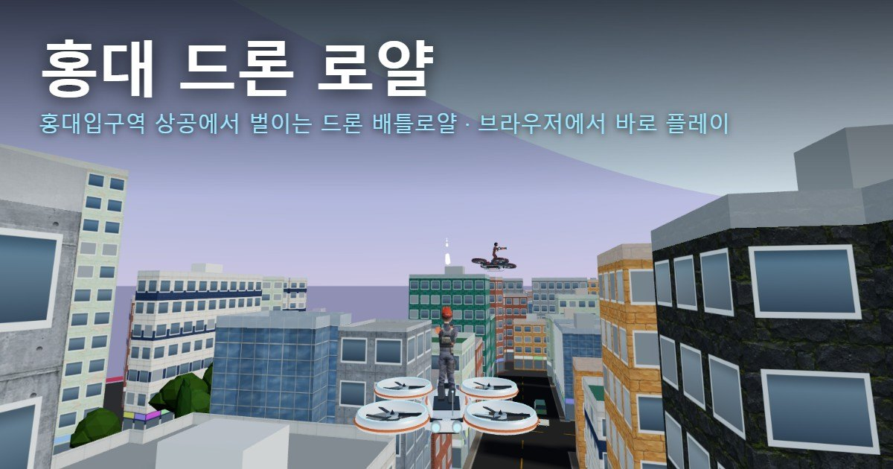

# 홍대 드론 로얄

홍대입구역 상공을 드론으로 날며 레이저로 겨루는 브라우저 배틀로얄 게임입니다. 홍대입구역 9번출구 반경 1km를 OpenStreetMap 데이터로 만든 3D 도시가 무대입니다.

**▶ 바로 플레이: https://jihunyangai.github.io/3d_planegame/** (설치 없음, PC의 키보드·마우스 필요)

[](https://jihunyangai.github.io/3d_planegame/)

## 게임

- 8명 중 마지막까지 살아남으면 우승입니다. 적 7명은 AI이고, 플레이어는 목숨이 3개입니다.
- 자기장이 단계별로 줄어들고, 공원에는 수리 키트·쌍발 레이저·부스트 강화 아이템이 놓입니다.
- 난이도는 쉬움·보통·어려움, 시간대는 낮·노을·밤 중에서 고릅니다.
- 도로에는 신호를 지키는 차와 보행자가 다니고, 건물·나무·표지판·차에 부딪힙니다.

### 조작

| 키 | 동작 |
| --- | --- |
| 마우스 | 조준 · 기수 방향 |
| `W` / `S` | 전진 / 후진 |
| `←` / `→` | 좌우 선회 |
| `↑` / `↓` | 상승 / 하강 |
| `Space`, 좌클릭 | 레이저 |
| `Shift` | 부스트 |
| 우클릭 | 줌 |
| `[` / `]` | 마우스 감도 |
| `1` / `2` / `3` | 난이도 (시작·일시 정지 화면) |
| `T` | 시간대 |
| `R` / `M` / `Esc` | 새 경기 / 소리 / 일시 정지 |

### 내 컴퓨터에서 실행

```
python serve.py
```

을 실행하고 브라우저에서 `http://localhost:8765/`를 엽니다. (`index.html`은 파일을 직접 열면 동작하지 않습니다. `serve.py`는 브라우저가 예전 파일을 캐시해 두지 않게 하는 작은 서버입니다.) three.js를 CDN에서 불러오므로 인터넷 연결이 필요합니다.

### 고쳐 쓰기

- 게임용 지도 `map_game.js`는 도로를 넓히고(대로 36m, 중간 도로 24m, 골목 14m) 건물 높이를 1.5배(최소 12m)로 키운 것입니다. `python build_map.py --game`으로 다시 만들며 `shapely`가 필요합니다.
- 조작감과 수치는 `js/config.js`에서 바꿉니다.
- 건물 외벽과 조종사는 `assets/`의 그림을 씁니다. 원본을 바꾸면 `python tools/build_assets.py`로 게임용 파일(`assets/game/`)을 다시 만듭니다(`Pillow`, `numpy` 필요).

## 3D 지도 뷰어

게임의 바탕이 된 지도만 둘러보는 페이지입니다: https://jihunyangai.github.io/3d_planegame/viewer.html (내려받았다면 `viewer.html`을 브라우저로 열면 됩니다.)

- 왼쪽 드래그 회전 · 오른쪽 드래그 이동 · 휠 확대/축소
- 건물에 마우스를 올리면 이름·높이·면적 표시
- 시간 슬라이더(5~23시)로 낮·노을·밤 전환
- `H` 키로 안내판 숨기기

## 구성

| 파일 | 내용 |
| --- | --- |
| `index.html`, `js/` | 드론 게임 (`city.js` 도시 렌더링, `world.js` 충돌, `drone.js` 드론, `weapons.js` 레이저, `fighter.js` 체력·실드, `nav.js` 길찾기, `bots.js` 적 AI, `zone.js` 자기장, `items.js` 아이템, `dronemodel.js` 드론 기체, `pilot.js` 조종사·레이저총, `trees.js` 나무 여섯 종, `cars.js` 차량 20종, `street.js` 신호등·표지판, `people.js` 보행자, `fx.js` 효과, `audio.js` 효과음, `main.js` 게임 루프) |
| `map_game.js` | 게임용 지도 데이터 (`build_map.py --game`이 생성) |
| `assets/` | 참고 그림 원본 (건물 외벽, 캐릭터, 총, 차량) |
| `assets/game/`, `tools/build_assets.py` | 게임이 불러 쓰는 가공된 텍스처와 그 생성 스크립트 |
| `serve.py` | 캐시를 끈 로컬 서버 |
| `viewer.html` | 3D 지도 뷰어 (three.js) |
| `map_data.js` | 뷰어용 지도 데이터 (`build_map.py`가 생성) |
| `build_map.py` | OSM 원본을 미터 좌표의 압축 데이터로 변환 |
| `data/` | Overpass API에서 받은 OSM 원본 |

지도 데이터를 다시 만들려면:

```
python build_map.py
```

중심이나 반경을 바꾸려면 `build_map.py`의 `LAT0`, `LON0`, `RADIUS`를 고치고 `data/`의 OSM 원본을 같은 범위로 새로 받아야 합니다.

## 실제와 다른 점

- 건물 윤곽과 높이만 OSM 데이터입니다. 높이·층수 정보가 없는 건물(약 73%)은 종류와 면적으로 추정했습니다.
- 창문, 간판, 벽 색, 옥상 구조물, 차량, 대부분의 나무는 규칙으로 자동 생성한 것입니다.
- 지형 고저차는 반영하지 않아 전부 평지입니다.

## 데이터 출처

지도 데이터 © [OpenStreetMap](https://www.openstreetmap.org/copyright) 기여자, [ODbL](https://opendatacommons.org/licenses/odbl/) 라이선스.
